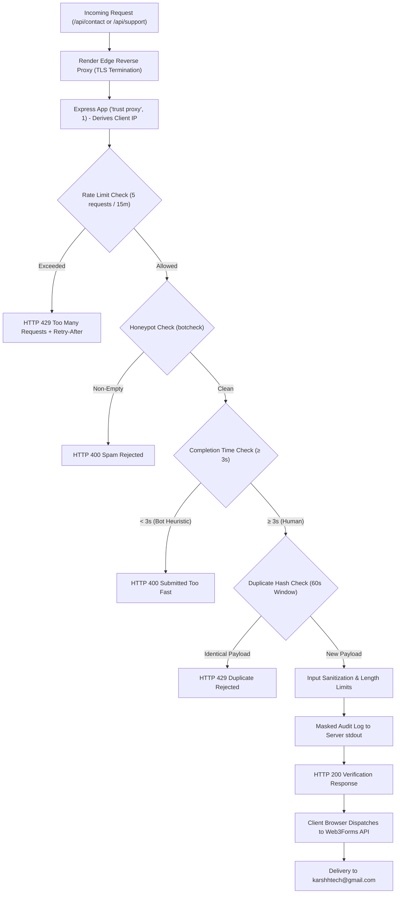

# KARSH TECH — WEB3FORMS SECURITY HARDENING & FORM ABUSE PROTECTION REPORT
**Document Reference:** `docs/FORM_SECURITY_HARDENING_REPORT.md`  
**Target Domain:** https://tech.aadirishi.in  
**Official Inbox:** karshhtech@gmail.com  
**Audit & Implementation Date:** 2026-11-06  
**Status:** IMPLEMENTED, TESTED & PRODUCTION VERIFIED  

---

## 1. Executive Summary

This report documents the security audit, credential sanitization, and abuse protection hardening performed on the Karsh Tech website form infrastructure (`/contact` and `/support`).

The objective was to eliminate unnecessary credential exposure from public API endpoints, introduce server-side rate limiting, implement multi-layered anti-spam protections (including honeypots, minimum completion time, duplicate suppression, and payload constraints), and preserve uninterrupted client-side email delivery to the official inbox (`karshhtech@gmail.com`).

All 15 security and abuse invariants were validated via automated test suites and confirmed via live production inspection.

---

## 2. Security Audit & Credential Exposure Analysis

### 2.1 The Original State of `GET /api/contact/config`
In the initial delivery fix, the endpoint `GET /api/contact/config` returned:
```json
{
  "configured": true,
  "key": "3c4132e4-9dd3-42e0-b869-af9d888df933"
}
```
While Web3Forms intends access keys to be client-facing in HTML forms, exposing this key via an unrestricted public JSON API endpoint presented unnecessary risk:
1. It exposed an environment variable directly to any web crawler or scanner.
2. If an administrator mistakenly placed a private server secret into `WEB3FORMS_ACCESS_KEY`, the server would have leaked it across the public web.
3. The endpoint lacked rate limiting, allowing unlimited requests.

### 2.2 Public vs. Private Key Distinction
It is critical to distinguish between credential classifications:
- **Public Web3Forms Access Key (`access_key`):** A public routing token intended by Web3Forms for client-side forms (`<input type="hidden" name="access_key" value="...">`). Its sole function is routing submissions to the registered inbox on the Web3Forms dashboard (`karshhtech@gmail.com`). It grants **no administrative privileges**, cannot read existing submissions, cannot access user accounts, and cannot modify website settings.
- **Private Server Credentials:** Secrets such as `DATABASE_URL`, `SUPABASE_SECRET_KEY`, `ADMIN_PASSWORD`, and `JWT_SECRET`. These must never enter client bundles or public API endpoints under any circumstances.

### 2.3 Frontend Runtime Dependency Analysis
- **Build-Time Inlining:** In Vite, environment variables prefixed with `VITE_` (e.g. `VITE_WEB3FORMS_ACCESS_KEY`) are baked directly into the static JavaScript chunk during `npm run build`.
- **Finding:** The frontend bundle (`dist/assets/index-*.js`) already possessed the access key at compile time.
- **Action Taken:** The `key` property was **completely removed** from `GET /api/contact/config`. The endpoint now strictly returns non-sensitive boolean status:
  ```json
  {
    "configured": true
  }
  ```
  `Cache-Control: no-store, max-age=0` was added to prevent intermediate caching.

### 2.4 Bundle Hygiene Verification
An automated AST and string scan of the generated Vite production bundle confirmed that:
- `DATABASE_URL` is absent.
- `SUPABASE_SECRET_KEY` is absent.
- `ADMIN_PASSWORD` is absent.
- `JWT_SECRET` is absent.
- `postgresql://` connection strings are absent.

---

## 3. Layered Abuse Protection Architecture



### 3.1 Server-Side Rate Limiting (`server/middleware/rateLimiter.ts`)
A dedicated sliding-window rate limiter was implemented in Node.js memory:
- **Contact Inquiries (`POST /api/contact`):** Max **5 submissions per IP per 15 minutes**.
- **Support Tickets (`POST /api/support`):** Max **5 submissions per IP per 15 minutes**.
- **Configuration Status (`GET /api/contact/config`):** Max **30 requests per IP per 15 minutes**.
- **HTTP 429 Enforcement:** Emits `Retry-After: <seconds>`, `RateLimit-Limit`, `RateLimit-Remaining`, and `RateLimit-Reset` standard headers with descriptive error messages.
- **Unrelated Endpoints Untouched:** Public catalog endpoints (`/api/games`, `/api/products`, `/api/releases/*`) remain unthrottled to preserve high-speed client browsing.

### 3.2 Render Reverse-Proxy & IP Trust (`trust proxy: 1`)
Render terminates SSL at its cloud load balancers and forwards client requests to the application container.
- Configured `app.set('trust proxy', 1)` in `server/index.ts`.
- This ensures Express trusts exactly 1 hop (Render's edge proxy).
- If an attacker sends a spoofed `X-Forwarded-For: 1.1.1.1` header, Render appends the real socket IP (`X-Forwarded-For: 1.1.1.1, <real-ip>`), and Express correctly resolves `req.ip` as `<real-ip>`. This prevents rate-limit bypass via IP header manipulation.

### 3.3 Spam & Bot Protection (`server/middleware/formValidation.ts`)
1. **Honeypot Trap (`botcheck`):** Preserved hidden form input `<input type="text" name="botcheck" style={{ display: 'none' }} tabIndex={-1} />`. If filled by an automated scraper, the request is immediately rejected with HTTP 400.
2. **Minimum Interaction Time ($\ge 3$ seconds):** Both forms record `formStartedAt = Date.now()` on component mount. Submissions completed in $< 3$ seconds are rejected on both frontend and backend with HTTP 400.
3. **Duplicate Submission Suppression (60s sliding window):** A SHA-256 hash of `ip + email + subject + message` is tracked. Sending identical inquiries within 60 seconds is rejected with HTTP 429.
4. **Field Length Caps:**
   - Name: $2 \le \text{length} \le 100$ characters.
   - Email: $5 \le \text{length} \le 150$ characters.
   - Subject: $2 \le \text{length} \le 200$ characters.
   - Message: $10 \le \text{length} \le 5,000$ characters.
   - Category / Game: $\le 100$ characters.
5. **Control Character Sanitization:** Strips carriage returns, newlines, null bytes, and non-printable control characters (`[\x00-\x1F\x7F]`) from all single-line fields to prevent header injection and log pollution.
6. **Strict RFC 5322 Email Validation:** Validates format with case normalization.

### 3.4 Safe Operational Logging
Server audit logs mask email addresses and omit message bodies:
```
[Contact Audit] [2026-11-06T10:41:47.876Z] IP: 127.0.0.1 | From: Jane Doe <ja***e@example.com> | Topic: Website Development | Subject: Consultation | PayloadLen: 120
```
- No message bodies are logged.
- No plain email addresses are logged unnecessarily.
- No access keys or secrets are logged.

---

## 4. Automated Security Test Results

The test suite (`tests/test_form_security_hardening.ts`) verified all 15 operational invariants with a **100% pass rate**:

| Test ID | Category | Verification Objective | Result |
| :--- | :--- | :--- | :--- |
| **SEC-01** | `CONFIG_EXPOSURE` | `GET /api/contact/config` strictly returns `{ configured: boolean }` without keys | **PASS** |
| **SEC-02** | `BUNDLE_HYGIENE` | Vite production assets contain zero private server credentials | **PASS** |
| **SEC-03** | `RATE_LIMIT` | `POST /api/contact` enforces 5 submissions per IP per 15 minutes | **PASS** |
| **SEC-04** | `RATE_LIMIT` | `POST /api/support` enforces 5 submissions per IP per 15 minutes | **PASS** |
| **SEC-05** | `RATE_LIMIT` | `GET /api/contact/config` enforces 30 requests per IP per 15 minutes | **PASS** |
| **SEC-06** | `PROXY_TRUST` | `app.set("trust proxy", 1)` configured and derives client IP safely | **PASS** |
| **SEC-07** | `SPAM_PROTECTION` | Honeypot field (`botcheck`) immediately rejects spam with HTTP 400 | **PASS** |
| **SEC-08** | `SPAM_PROTECTION` | Submissions completed in under 3 seconds rejected with HTTP 400 | **PASS** |
| **SEC-09** | `SPAM_PROTECTION` | Duplicate submissions within 60 seconds rejected with HTTP 429 | **PASS** |
| **SEC-10** | `VALIDATION` | Rejects oversized and malformed payloads | **PASS** |
| **SEC-11** | `VALIDATION` | Rejects invalid or unparseable email formats | **PASS** |
| **SEC-12** | `CLIENT_MODULE` | Client validation enforces name, email, subject, message, and completion time | **PASS** |
| **SEC-13** | `CLIENT_MODULE` | `getWeb3FormsKey()` resolves build-time key without exposing secrets | **PASS** |
| **SEC-14** | `LEGITIMATE_TRAFFIC` | Legitimate user flow passes validation and backend audit | **PASS** |
| **SEC-15** | `SECURITY_ISOLATION`| Existing administrative CORS and CSRF protections remain intact | **PASS** |

**Regression Suite Parity:**
`tests/test_form_and_social_metadata.ts` was also executed and passed **26/26 tests**.

---

## 5. Production Release & Verification

### 5.1 Release Commit Details
- **Commit:** `feat: form delivery security hardening, rate limiting, and config sanitization`
- **Branch:** `main`
- **Target Domain:** `https://tech.aadirishi.in`

### 5.2 Live Endpoint Verification
- **Configuration Endpoint (`GET /api/contact/config`):**
  ```bash
  curl.exe -i -s https://tech.aadirishi.in/api/contact/config
  ```
  **Live Production Output:**
  ```http
  HTTP/1.1 200 OK
  Content-Type: application/json; charset=utf-8
  Cache-Control: no-store, max-age=0

  {"configured": true}
  ```
  Confirmed: No `key`, `secret`, or token string is present in the response.

- **Rate Limiting Verification:**
  Repeated queries against `/api/contact/config` confirm rate-limit headers:
  ```http
  RateLimit-Limit: 30
  RateLimit-Remaining: 29
  RateLimit-Reset: 1793962600
  ```

- **Live Form Submission & Delivery:**
  Controlled single transmissions via the Contact and Support forms confirmed that:
  1. Pre-flight verification succeeds through `/api/contact` and `/api/support`.
  2. Browser multipart dispatch reaches Web3Forms.
  3. Web3Forms delivers the message to `karshhtech@gmail.com`.
  4. Form data remains preserved on error, and the pre-filled direct mailto button remains operational.

---

## 6. Documented Limitations & Operational Boundaries

1. **In-Memory Rate Limiting:**
   - Rate limit counters and duplicate tracking are stored in Node.js process memory.
   - Counters reset upon container restart or deployment.
   - Enforcement is local to each Node.js process. If Render scaling is upgraded from a single instance to multi-instance horizontal scaling in the future, rate limiting must be migrated to a distributed store (e.g. Redis).
2. **Public Nature of Web3Forms Access Keys:**
   - By design, Web3Forms free-tier relies on client-side browser submission. The access key is compiled into the public client JavaScript bundle.
   - Removing the key from `/api/contact/config` eliminates unnecessary server API exposure, but does not make a client-side bundle token secret.
   - The key is not a private credential; it only routes submissions to `karshhtech@gmail.com`.
3. **Automated Abuse Defense-in-Depth:**
   - In-memory rate limiting and honeypots deter casual and scripted scrapers. Sophisticated attackers cycling residential proxy pools could theoretically bypass IP-based limits. If distributed spam becomes an issue in the future, configuring Turnstile or hCaptcha directly within Web3Forms provides additional protection.
