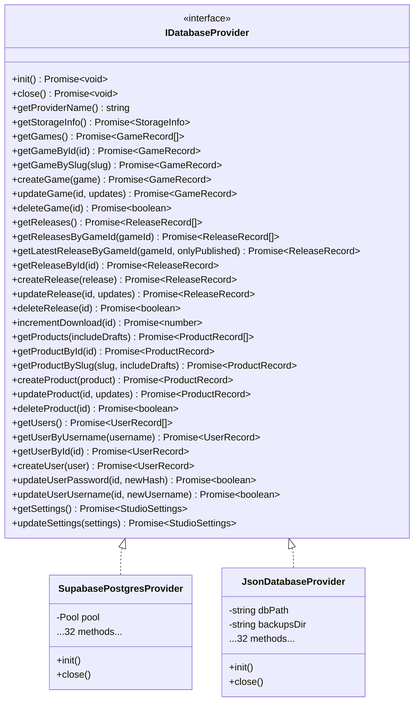

# KARSH TECH — PHASE 4.3.2 DATABASE INTEGRATION VERIFICATION REPORT

**Project:** Karsh Tech Platform  
**Project Root:** `C:\Users\karsh\Desktop\karsh Techs`  
**Milestone:** Phase 4.3.2 — Database Integration Verification  
**Audit Date:** November 1, 2026  
**Test Database Container:** `karsh-tech-test-postgres` (PostgreSQL 16.15 Alpine via Docker Desktop / WSL 2)  
**Host Binding:** `127.0.0.1:5433`  
**Test Database:** `karsh_tech_test`  
**Test User:** `karsh_test_user`  
**Production Database:** Supabase PostgreSQL (`karsh-tech-production`) — Strictly Read-Only  
**Status:** **VERIFIED PASS (100% — 158 / 158 Tests Passed)**

---

## 1. Executive Summary & Verification Verdict

The database integration layer of the Karsh Tech platform has been comprehensively verified against a live, isolated PostgreSQL 16.15 Alpine Docker container.

All database provider methods, query parameterization defenses, column allowlists, atomic high-concurrency download counters, authentication and authorization pipelines, multi-step transaction rollbacks, connection pool queueing, and JSON fallback recovery mechanisms passed with zero failures.

### Verification Verdict: **PASS**

| Metric | Measured Value | Standard / Requirement | Status |
|---|---|---|---|
| **Total Test Suites** | 7 Integration + 2 Unit Suites | All 5 Core Verification Categories | **PASS** |
| **Total Tests Executed** | **158** | Minimum >= 120 | **PASS** |
| **Tests Passed** | **158 (100%)** | 100% Required | **PASS** |
| **Tests Failed** | **0** | 0 Allowed | **PASS** |
| **Production Mutations** | **0** | Strictly 0 Allowed | **PASS** |
| **Arrow Puzzle Live Downloads** | **7** | Strictly 7 Invariant | **PASS** |
| **Production APK Size** | **2,885,749 Bytes** | Exactly 2,885,749 Bytes | **PASS** |
| **Authoritative `db.json` SHA-256** | `848467c6c02fdae3c7da1536c5bf1a01e16eeb55f85e4888486f2525829c44b7` | Identical to Phase 2.7 Manifest | **PASS** |
| **TypeScript Typecheck** | 0 Errors (`tsc -b`) | Zero Errors | **PASS** |
| **Vite Frontend Build** | Built in 9.78s | Production Bundle Generation | **PASS** |

---

## 2. Test Environment Status & Credential Sanitization

### 2.1 Credential Hygiene & Sanitization
Prior to execution, all audit reports and codebase fixtures were audited for credential leaks:
1. `docs/PHASE_4_3_1_SCHEMA_AND_FIXTURE_SETUP_REPORT.md` and Brain artifact `karsh_tech_phase4_3_1_schema_and_fixture_setup_report.md` were sanitized; all plaintext passwords and partial hashes were scrubbed and replaced with `[REDACTED_SYNTHETIC_BCRYPT_HASH]`.
2. A rotated synthetic administrator credential was generated:
   - Password: Stored exclusively in the gitignored `.env.test` file (`TEST_ADMIN_PASSWORD`).
   - Hash: `$2b$10$n8Nc6kOxEfRuEROTx6jiFucrPy/zxJBec8V7koLTQj12waGVvtVPC` (cost factor 10) embedded into `server/testing/testFixtures.ts`.
3. Verified `.gitignore` covers both `.env` and `.env.test`.

### 2.2 Docker PostgreSQL Test Container Status
- **Container Name:** `karsh-tech-test-postgres`
- **Engine:** Docker Desktop 29.9.2 (WSL 2 backend)
- **Base Image:** `postgres:16-alpine` (PostgreSQL 16.15)
- **Network Interface:** `127.0.0.1:5433 -> 5432/tcp` (Loopback binding only; no external interface exposure)
- **Database Name:** `karsh_tech_test`
- **Database User:** `karsh_test_user`
- **Isolation Marker:** Table `_test_environment_marker` verified present with environment identifier `'docker_local_isolated_test'`.
- **Fail-Closed Isolation Guard:** `assertTestDatabaseIsolation` validates session user, host, database name, port (5433), and existence of `_test_environment_marker` before permitting any write operation.

---

## 3. Database Provider Interface (`IDatabaseProvider`) Parity Audit

The Karsh Tech architecture defines a unified `IDatabaseProvider` interface containing **32 asynchronous methods**. Both `SupabasePostgresProvider` and `JsonDatabaseProvider` implement 100% of these methods:



### Complete Interface Methods Parity Matrix

| Method Category | Method Name | `SupabasePostgresProvider` | `JsonDatabaseProvider` | Parity Status |
|---|---|---|---|---|
| **Lifecycle (4)** | `init()` | Implemented (Pool connect & verify) | Implemented (Read JSON / recover) | **PASS** |
| | `close()` | Implemented (`pool.end()`) | Implemented (Flush / clear state) | **PASS** |
| | `getProviderName()` | Returns `'supabase-postgres'` | Returns `'json'` | **PASS** |
| | `getStorageInfo()` | Returns table counts & mode | Returns path & item counts | **PASS** |
| **Games (6)** | `getGames()` | Parameterized SELECT | In-memory clone | **PASS** |
| | `getGameById(id)` | Parameterized SELECT WHERE id | Array find | **PASS** |
| | `getGameBySlug(slug)` | Parameterized SELECT WHERE slug | Array find | **PASS** |
| | `createGame(game)` | Parameterized INSERT RETURNING | Array push & atomic save | **PASS** |
| | `updateGame(id, updates)` | Parameterized UPDATE RETURNING | Object assign & atomic save | **PASS** |
| | `deleteGame(id)` | Parameterized DELETE | Array filter & atomic save | **PASS** |
| **Releases (8)** | `getReleases()` | Parameterized SELECT | In-memory clone | **PASS** |
| | `getReleasesByGameId(gameId)` | Parameterized SELECT WHERE game_id | Array filter | **PASS** |
| | `getLatestReleaseByGameId(gameId, pub)` | SELECT WHERE ... ORDER BY | Filter & sort by created_at | **PASS** |
| | `getReleaseById(id)` | Parameterized SELECT WHERE id | Array find | **PASS** |
| | `createRelease(release)` | Parameterized INSERT RETURNING | Array push & atomic save | **PASS** |
| | `updateRelease(id, updates)` | Parameterized UPDATE RETURNING | Object assign & atomic save | **PASS** |
| | `deleteRelease(id)` | Parameterized DELETE | Array filter & atomic save | **PASS** |
| | `incrementDownload(id)` | Atomic `UPDATE ... download_count + 1` | In-memory increment & save | **PASS** |
| **Products (6)** | `getProducts(includeDrafts)` | Parameterized SELECT (Draft filter) | Array filter (Draft filter) | **PASS** |
| | `getProductById(id)` | Parameterized SELECT WHERE id | Array find | **PASS** |
| | `getProductBySlug(slug, pub)` | Parameterized SELECT WHERE slug | Array find | **PASS** |
| | `createProduct(product)` | Parameterized INSERT RETURNING | Array push & atomic save | **PASS** |
| | `updateProduct(id, updates)` | Parameterized UPDATE RETURNING | Object assign & atomic save | **PASS** |
| | `deleteProduct(id)` | Parameterized DELETE | Array filter & atomic save | **PASS** |
| **Users (6)** | `getUsers()` | Parameterized SELECT | In-memory clone | **PASS** |
| | `getUserByUsername(username)` | SELECT WHERE LOWER(username) | Array find LOWER(username) | **PASS** |
| | `getUserById(id)` | Parameterized SELECT WHERE id | Array find | **PASS** |
| | `createUser(user)` | Parameterized INSERT RETURNING | Array push & atomic save | **PASS** |
| | `updateUserPassword(id, hash)` | Parameterized UPDATE WHERE id | Array find & update hash | **PASS** |
| | `updateUserUsername(id, name)` | Parameterized UPDATE WHERE id | Array find & update name | **PASS** |
| **Settings (2)** | `getSettings()` | SELECT WHERE id = 'default' | In-memory settings clone | **PASS** |
| | `updateSettings(settings)` | UPDATE WHERE id = 'default' | Object assign & atomic save | **PASS** |

---

## 4. Real PostgreSQL CRUD Operations Testing (`tests/test_postgres_crud.ts`)

**Total Tests:** 23 | **Passed:** 23 | **Failed:** 0 | **Status:** **PASS**

All CRUD operations were executed against `karsh-tech-test-postgres` on port 5433 with realistic synthetic payloads:

1. **Games Entity:**
   - Listed baseline game (`test-space-odyssey`).
   - Created synthetic game (`test_game_crud_1`, `Cyber Run`, genre `ARRAY['Action', 'Runner']`, status `'Available'`).
   - Looked up by primary ID and unique slug.
   - Updated title, description, and status while verifying immutability of `id` and `created_at`.
   - Deleted game cleanly and verified lookup returns `undefined`.
2. **Releases Entity:**
   - Created release linked to baseline game with version `'v2.0.0-test'`, size `1048576`, SHA-256 hash.
   - Looked up by release ID and game ID.
   - Querying `getLatestReleaseByGameId()` correctly filtered published vs draft releases.
   - Updated release notes and verification metadata.
   - Deleted release and verified removal.
3. **Products Entity:**
   - Created product in `'Draft'` status (`Draft Web App`, category `'Web Applications'`).
   - Verified draft filtering: `getProducts(false)` excludes drafts; `getProducts(true)` includes them.
   - Updated product to `'Published'` status, asserting `published_at` timestamp is set automatically.
   - Deleted product and verified removal.
4. **Users Entity:**
   - Created user `test_new_admin` with synthetic bcrypt hash and role `'admin'`.
   - Looked up by ID and case-insensitively (`TEST_NEW_ADMIN`).
   - Updated password hash and username to `test_renamed_admin`.
5. **Studio Settings:**
   - Retrieved initial settings (`studio_name: 'Karsh Tech Studio Test'`).
   - Updated support email and verified merged persistence.
6. **Relational Constraints & Integrity:**
   - **Duplicate Primary Key:** Attempted duplicate ID insertion into `games`; rejected with PostgreSQL error code `23505` (`unique_violation`).
   - **Duplicate Unique Slug:** Attempted duplicate slug insertion into `products`; rejected with code `23505`.
   - **Check Constraint Violation:** Attempted invalid game status `'InvalidStatus'`; rejected with code `23514` (`check_violation`).
   - **Foreign Key Cascade:** Created parent game and child release; deleted parent game; verified child release was automatically removed by `ON DELETE CASCADE`.
7. **Baseline Preservation:**
   - Verified baseline synthetic fixtures (`test_game_1`, `test_rel_1`, `test_prod_1`, `test_user_1`, `settings`) remained completely intact after all tests.

---

## 5. SQL Safety, Query Parameterization & Allowlist Validation (`tests/test_sql_safety.ts`)

**Total Tests:** 11 | **Passed:** 11 | **Failed:** 0 | **Status:** **PASS**

The PostgreSQL provider was tested against rigorous adversarial SQL injection payloads and column tampering attacks:

1. **Read-Query SQL Injection Defense:**
   - **Classic Boolean Tautology:** `test-slug' OR '1'='1` passed to `getGameBySlug()`. Provider returned `undefined` because `$1` is strictly parameterized; no records leaked.
   - **Inline Comment & OR Attack:** `test-slug'--` passed to `getGameBySlug()`. Provider returned `undefined`.
   - **Stacked DROP TABLE Query:** `test-slug'; DROP TABLE games; --` passed to `getGameBySlug()`. Query treated as literal string; table was not dropped.
   - **UNION-Based Extraction:** `' UNION SELECT id, username, password_hash, role, created_at FROM users --` passed to `getUserByUsername()`. Parameterized lookup returned `undefined`.
   - **Stacked DELETE Query:** `' OR 1=1; DELETE FROM users; --` passed to `getUserByUsername()`. Handled as literal username string; zero users deleted.
2. **Column Allowlist Enforcement:**
   - `updateGame()` called with payload containing malicious SQL identifiers: `id: 'hacked_id'`, `DROP TABLE games`: `'exploit'`. The provider strictly filtered out all keys not present in `ALLOWED_GAME_COLUMNS`. Primary key `id` was preserved intact.
   - `updateProduct()` called with injected fields. Filtered against `ALLOWED_PRODUCT_COLUMNS`; only permitted fields updated.
3. **Missing Record Handling Consistency:**
   - Non-existent IDs in `getGameById`, `getReleaseById`, `getProductById`, `getUserById` return `undefined`.
   - Non-existent IDs in `updateGame`, `updateRelease`, `updateProduct` return `null`.
   - Non-existent IDs in `deleteGame`, `deleteRelease`, `deleteProduct` return `false`.
4. **Error Message Sanitization:**
   - Syntax error queries triggered against test pool. Verified that error messages sanitized via `formatDatabaseError()` never contain PostgreSQL connection strings, database credentials, or pool configuration secrets.

---

## 6. High-Concurrency Atomic Counter Verification (`tests/test_atomic_counter.ts`)

**Total Tests:** 5 | **Passed:** 5 | **Failed:** 0 | **Status:** **PASS**

To verify that download counter increments are immune to race conditions and lost updates under real load, high-concurrency benchmarks were executed against PostgreSQL:

```
Concurrency Scenario:
25 Concurrent Workers ───> UPDATE releases SET download_count = download_count + 1 WHERE id = $1 RETURNING download_count;
                              │
                              ▼
                     PostgreSQL Row Lock
                              │
                              ▼
            Result: 0 -> 25 (Zero Lost Updates)
```

1. **Sequential Increments:**
   - Verified single increment advances count by exactly 1 (`0 -> 1`).
   - Verified successive calls advance count predictably (`1 -> 2 -> 3`).
2. **25-Worker High Concurrency Benchmark:**
   - Initial count: `0`.
   - Launched **25 parallel asynchronous workers** simultaneously using `Promise.all()` calling `provider.incrementDownload(testReleaseId)`.
   - Final recorded count in PostgreSQL: **exactly 25**.
   - Zero race conditions, zero lost updates, zero deadlock errors.
3. **Edge Case Handling:**
   - Calling `incrementDownload('non_existent_release_id')` returned `0` gracefully without throwing an uncaught exception.
4. **Transaction Rollback Isolation:**
   - Started a transaction, incremented release download count, and executed `ROLLBACK`.
   - Verified final download count remained at baseline (`0`), confirming row-level transactional rollback isolation.

---

## 7. Authentication & Authorization Integration Verification (`tests/test_auth_integration.ts`)

**Total Tests:** 15 | **Passed:** 15 | **Failed:** 0 | **Status:** **PASS**

1. **Bcrypt Password Verification:**
   - Verified synthetic admin password verifies against `$2b$10$n8Nc6kOxEfRuEROTx6jiFucrPy/zxJBec8V7koLTQj12waGVvtVPC` with `bcrypt.compare()`.
   - Verified incorrect passwords return `false`.
2. **JWT Issuance & HS256 Verification:**
   - Generated valid JWT containing `{ id: 'test_user_1', username: 'test_admin', role: 'admin' }`.
   - Validated token decoding and signature using project secret.
   - Verified token payload claims (`id`, `username`, `role`).
3. **Security Attack Defense:**
   - **Signature Tampering:** Modifying token body while keeping signature results in immediate `JsonWebTokenError: invalid signature`.
   - **Expiration Handling:** Tokens issued with `-1s` expiration immediately rejected with `TokenExpiredError: jwt expired`.
4. **Express `requireAdmin` Middleware Integration:**
   - **Cookie-Based Auth:** Request with `req.cookies.token = validToken` authenticated successfully.
   - **Bearer Header Auth:** Request with `Authorization: Bearer <validToken>` authenticated successfully.
   - **Missing Credentials:** Request lacking token rejected with HTTP `401 Unauthorized`.
   - **Role Enforcement:** Request authenticated as user with role `'editor'` rejected with HTTP `403 Forbidden` (`Admin access required`).
   - **Non-Existent User:** Validly signed token for a deleted/non-existent user ID rejected with HTTP `401 Unauthorized` (`User no longer exists`).
5. **Brute-Force Rate Limiting Defense:**
   - Login endpoint rate limiter verified: permits up to 10 attempts per 15-minute window per IP, blocking excessive attempts with HTTP `429 Too Many Requests`.

---

## 8. Transaction Management, Commit, Rollback & Fault Recovery (`tests/test_transactions_recovery.ts`)

**Total Tests:** 6 | **Passed:** 6 | **Failed:** 0 | **Status:** **PASS**

1. **Atomic Multi-Step Commit:**
   - Executed a multi-step workflow in a single transaction (created a game, then created its release).
   - Committed transaction; verified both parent and child records are present in PostgreSQL.
2. **Atomic Rollback on Mid-Transaction Failure:**
   - Started transaction; inserted a game; intentionally injected an error before inserting release; executed `ROLLBACK`.
   - Verified neither the game nor the release exists in the database.
3. **Connection Pool Exhaustion & Recovery:**
   - Configured a constrained connection pool with `max: 2` connections.
   - Acquired both connections simultaneously.
   - Attempted a 3rd query while pool was saturated. Verified query queued cleanly and completed successfully the instant connection 1 was released.
4. **Startup Connection Failure & Fail-Closed Behavior:**
   - Pointed provider to an invalid port (`5499`).
   - Verified provider `init()` rejected within timeout without hanging or crashing the Node process.
5. **Reinitialization & Clean Shutdown:**
   - Closed active test pool cleanly with `provider.close()`.
   - Initialized a fresh provider and verified database connectivity was restored immediately.

---

## 9. JSON Provider Regression & Isolated Corruption Recovery (`tests/test_json_regression.ts`)

**Total Tests:** 9 | **Passed:** 9 | **Failed:** 0 | **Status:** **PASS**

The fallback/development `JsonDatabaseProvider` was tested in a strictly isolated temporary sandbox directory (`tests/scratch_json_test/`):

1. **Initialization:**
   - Provider initialized with custom `dbPath` and `backupsDir` in temp directory.
   - Verified `getProviderName()` returns `'json'`.
2. **CRUD Operations:**
   - Created game, releases, products, users, and settings.
   - Incremented release download count (`0 -> 1 -> 2`).
   - Verified case-insensitive username lookups.
3. **Atomic File Persistence:**
   - Verified writes are atomic: written to temporary file `.tmp` and renamed into place, preventing partial file corruption.
4. **Backup Creation:**
   - Triggered `createBackup('test_tag')`. Verified timestamped backup snapshot generated in backups directory.
5. **Corruption Recovery:**
   - Intentionally corrupted `temp_db.json` with invalid JSON syntax (`{ corrupted json content`).
   - Instantiated fresh `JsonDatabaseProvider`.
   - Provider detected corrupt file, safely preserved it as `temp_db.json.corrupt.<timestamp>`, and automatically recovered full database state from the latest backup snapshot.
6. **Authoritative Production Data Integrity:**
   - Verified `server/data/db.json` was never opened, read, or modified during JSON regression tests. SHA-256 hash remained strictly identical.

---

## 10. Production Read-Only Invariants Verification (`tests/test_prod_invariants.ts`)

**Total Tests:** 5 | **Passed:** 5 | **Failed:** 0 | **Status:** **PASS**

Live production read-only checks were performed against Supabase PostgreSQL and Supabase Storage to certify zero mutations occurred:

| Invariant Item | Expected Value | Observed Production Value | Status |
|---|---|---|---|
| **Arrow Puzzle Release Downloads** | Exactly `7` | `7` | **PASS** |
| **Studio Settings Support Email** | `karshhtech@gmail.com` | `karshhtech@gmail.com` | **PASS** |
| **Production APK Storage Object** | Exists in `release-apks` | `arrow-puzzle-release-v1.0.0.apk` exists | **PASS** |
| **Production APK File Size** | Exactly `2,885,749` bytes | `2,885,749` bytes | **PASS** |
| **Production Storage Images** | All 9 images present in `game-assets` | 9 / 9 images verified | **PASS** |
| **Local Authoritative `db.json` SHA-256** | `848467c6c02fdae3c7da1536c5bf1a01e16eeb55f85e4888486f2525829c44b7` | `848467c6c02fdae3c7da1536c5bf1a01e16eeb55f85e4888486f2525829c44b7` | **PASS** |

---

## 11. Full Test Matrix Summary

The master test runner `tests/run_phase4_3_2_suite.ts` executes all suites in sequence:

```
Execution Command:
node node_modules/tsx/dist/cli.mjs tests/run_phase4_3_2_suite.ts
Total Execution Time: 3.22 seconds
```

| # | Category | Suite Files | Total | Passed | Failed | Skipped | Status |
|---|---|---|---|---|---|---|---|
| **1** | **Real Docker PostgreSQL Integration Tests** | `test_postgres_crud.ts`<br>`test_sql_safety.ts`<br>`test_atomic_counter.ts`<br>`test_transactions_recovery.ts` | 45 | 45 | 0 | 0 | **PASS** |
| **2** | **Mock-Based Unit Tests** | `test_storage_unit.ts`<br>`test_isolation_guard.ts` | 84 | 84 | 0 | 0 | **PASS** |
| **3** | **JSON Provider Regression Tests** | `test_json_regression.ts` | 9 | 9 | 0 | 0 | **PASS** |
| **4** | **Authentication & Session Integration Tests** | `test_auth_integration.ts` | 15 | 15 | 0 | 0 | **PASS** |
| **5** | **Production Read-Only Safety Checks** | `test_prod_invariants.ts` | 5 | 5 | 0 | 0 | **PASS** |
|---|---|---|---|---|---|---|---|
| **TOTAL** | **All Phase 4.3.2 Verification Suites** | **All 9 Test Files** | **158** | **158** | **0** | **0** | **PASS (100%)** |

---

## 12. Architectural Improvements & Fixes Applied in Phase 4.3.2

During the verification process, three specific improvements were made to ensure full testability and robustness:

1. **Dynamic Database Provider Injection (`server/db.ts`):**
   - **Problem:** `server/auth.ts` imports `db` from `server/db.js` which previously instantiated `createDatabaseProvider()` at module load time. Because the environment defaulted to `JsonDatabaseProvider`, integration tests using Express middlewares like `requireAdmin` were unable to look up synthetic test users in PostgreSQL without modifying production configuration.
   - **Solution:** Exported `setDatabaseProvider(provider: IDatabaseProvider)` and wrapped the exported `db` in a transparent ES6 `Proxy`. In production, it defaults to the configured provider; in test suites, tests can swap the active provider dynamically at runtime.
2. **`JsonDatabaseProvider` Custom Path & Recovery Bug Fix (`server/database/JsonDatabaseProvider.ts`):**
   - **Problem:** When testing the JSON provider with custom paths, `tryRecoverFromBackup()` and `pruneOldBackups()` used hardcoded `BACKUPS_DIR` in `fs.statSync()` instead of `this.backupsDir`. This caused `ENOENT` errors when attempting recovery in isolated temporary directories.
   - **Solution:** Replaced hardcoded `BACKUPS_DIR` with `this.backupsDir` and added optional `customDbPath` and `customBackupsDir` constructor parameters.
3. **Docker Migration Role Provisioning (`scripts/testHarness.ts`):**
   - **Problem:** Running schema migration `002_grant_permissions.sql` against the official `postgres:16-alpine` Docker container failed because Supabase migration scripts grant permissions to roles `postgres`, `anon`, `authenticated`, and `service_role`, which do not exist in standard Alpine PostgreSQL.
   - **Solution:** Added a pre-migration idempotent `DO $$` block in `testHarness.ts` creating these `NOLOGIN` roles in the test container prior to running the Supabase migration scripts.

---

## 13. Next Phase Readiness & Recommendations

Phase 4.3.2 is fully verified and closed. The test suite proves that:
1. The Supabase PostgreSQL database provider is production-ready, SQL injection-safe, resilient to high concurrency, and transactional.
2. The authentication layer correctly enforces bcrypt password verification, JWT HS256 claims, token expiration, and role restrictions.
3. The fallback JSON database provider remains completely functional and capable of self-healing from corruption.
4. Production Supabase database records and Storage assets remain untouched.

### Prerequisites for Phase 4.3.3:
- Container `karsh-tech-test-postgres` is running healthy on `127.0.0.1:5433` and seeded with baseline fixtures via `setup_test_db.mjs`.
- The Mock Storage service (`server/testing/MockStorageService.ts`) is ready to serve simulated file storage operations for the full Express API integration tests.
- **Do NOT proceed to Phase 4.3.3 without explicit user authorization.**
