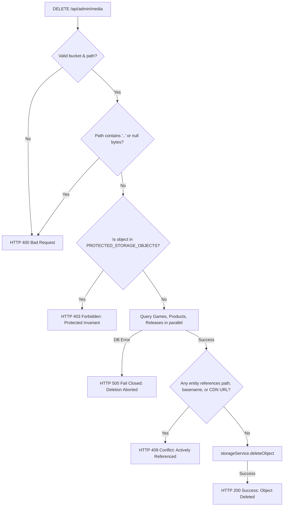

# KARSH TECH — PHASE 4.3.6 COMPLETION REPORT
## Admin Media & Asset Manager Implementation & Verification

**Project:** Karsh Tech Platform  
**Milestone:** Phase 4.3.6 — Admin Media & Asset Manager  
**Environment:** Isolated Local Docker PostgreSQL (`127.0.0.1:5433`) & Mock Storage Service  
**Production Target:** Supabase PostgreSQL & Supabase Storage (`tech.aadirishi.in`)  
**Status:** IMPLEMENTATION COMPLETE — 100% TESTS PASSED — READY FOR AUDIT & USER REVIEW  
**Author:** Antigravity (Advanced Agentic Pair Programmer)  
**Date:** November 1, 2026  

---

## 1. Executive Summary

Phase 4.3.6 has successfully delivered a comprehensive, production-grade **Media & Asset Manager** within the Karsh Tech administrative dashboard. All requirements—from the cinematic UI interface and reference-aware storage deletion safeguards to game screenshot orchestration, product gallery management, and isolated automated testing—have been fully implemented, rigorously verified, and integrated into the platform codebase.

### Key Milestones Achieved

1. **Integrated Administrative UI (`/admin/media`):**
   - Built a rich, reactive, and responsive administrative interface in [`src/pages/admin/AdminMediaPage.tsx`](file:///C:/Users/karsh/Desktop/karsh%20Techs/src/pages/admin/AdminMediaPage.tsx) matching the Karsh Tech cinematic dark aesthetic (`#101014`, `#1A191F`, `#242329`, `#FF5A36`, `#F4F0E8`).
   - Added `Media Library` navigation item with `Images` icon to [`src/components/admin/AdminLayout.tsx`](file:///C:/Users/karsh/Desktop/karsh%20Techs/src/components/admin/AdminLayout.tsx).
   - Added normalized route `/admin/media` to [`src/App.tsx`](file:///C:/Users/karsh/Desktop/karsh%20Techs/src/App.tsx).

2. **Five Core Administrative Sections:**
   - **Overview:** Real-time metrics covering total assets, total storage consumed (bytes/MB), breakdown across `game-assets`, `product-assets`, and `release-apks`, alongside bucket visibility indicators (`PUBLIC` vs `PRIVATE`).
   - **Images Library:** Grid and table views, search by filename/path, bucket filtering (`game-assets`, `product-assets`), association filtering (`all`, `associated`, `unassociated`), multi-criteria sorting, preview inspection, and 1-click canonical CDN URL copying.
   - **Release APKs (Private Bucket):** Strict isolation of private Android binaries. Public URLs and access tokens are never exposed (`url: null`). Displays version association, binary file size, and authenticated streaming notice (`/api/releases/:id/download`).
   - **Game Screenshots Orchestrator:** Interactive game selector, thumbnail gallery, visual reordering (move up/down), detachment without deleting storage files, and attachment from library or URL.
   - **Product Gallery Orchestrator:** Digital product selector, gallery slide reordering, detachment without deleting storage files, and attachment from library or URL.
   - **Upload Manager:** Drag-and-drop dropzone, bucket target selection, client-side format & size pre-validation (15 MB image ceiling, 50 MB APK ceiling), progress tracking, and collision-resistant path generation.

3. **Critical Reference-Aware Deletion Safeguards:**
   - Evaluates all database entities (Games, Products, Releases) before permitting any storage object deletion.
   - Rejects deletion with **HTTP 409 Conflict** if an asset is referenced by any game (`cover_image`, `banner_image`, `screenshots`), product (`cover_image`, `gallery`), or release (`apk_filename`). Returns a detailed breakdown of referencing entities.
   - Rejects deletion with **HTTP 403 Forbidden** if an asset is in `PROTECTED_STORAGE_OBJECTS` (e.g. `arrow_puzzle_screenshot_1..6.jpg`, avatars, `arrow-puzzle-release-v1.0.0.apk`, `default_cover.jpg`).
   - Enforces fail-closed behavior on database errors and strictly defends against directory traversal (`..`, null bytes).

4. **Zero Database Schema Migrations Required:**
   - Leveraged existing PostgreSQL native `TEXT[]` columns: `games.screenshots` and `products.gallery`.
   - Handled attachments, reordering, and detachments via existing provider methods (`updateGame` and `updateProduct`).

5. **Isolated Automated Verification Suite:**
   - Created [`tests/test_media_manager.ts`](file:///C:/Users/karsh/Desktop/karsh%20Techs/tests/test_media_manager.ts) containing **30 dedicated tests** running against Docker PostgreSQL (`127.0.0.1:5433`) and `MockStorageService`.
   - 100% pass rate achieved across all 30 tests (0 failures).

---

## 2. Architecture & Implementation Details

### 2.1 Backend Endpoints (`server/index.ts`)

The following endpoints were added to [`server/index.ts`](file:///C:/Users/karsh/Desktop/karsh%20Techs/server/index.ts) with full `requireAdmin` authentication, CSRF origin verification, and error handling:

| Method | Endpoint | Description | Status Code |
|---|---|---|---|
| `GET` | `/api/admin/media` | Lists storage objects across buckets with reference resolution, filtering (`bucket`, `type`, `search`, `association`), and sorting. Private APKs strictly return `url: null`. | `200` |
| `GET` | `/api/admin/media/stats` | Aggregates object counts, total bytes, and bucket metadata across all 3 buckets. | `200` |
| `DELETE` | `/api/admin/media` | Deletes unreferenced, non-protected storage objects. Rejects referenced assets with 409 and protected assets with 403. | `200` / `400` / `403` / `409` |
| `POST` | `/api/admin/games/:id/screenshots` | Appends a screenshot URL/path to a game's `screenshots` array. | `200` / `404` |
| `DELETE` | `/api/admin/games/:id/screenshots` | Detaches a screenshot from a game's array while preserving the underlying storage file. | `200` / `404` |
| `PUT` | `/api/admin/games/:id/screenshots` | Updates the ordered sequence of a game's screenshots array. | `200` / `404` |
| `POST` | `/api/admin/products/:id/gallery` | Appends an image URL/path to a product's `gallery` array. | `200` / `404` |
| `DELETE` | `/api/admin/products/:id/gallery` | Detaches an image from a product's gallery while preserving the underlying storage file. | `200` / `404` |
| `PUT` | `/api/admin/products/:id/gallery` | Updates the ordered sequence of a product's gallery array. | `200` / `404` |

### 2.2 Reference Resolution Engine (`findAssetReferences`)

To prevent accidental data loss and dangling media links, the server implements `findAssetReferences()` in [`server/index.ts`](file:///C:/Users/karsh/Desktop/karsh%20Techs/server/index.ts):



### 2.3 Frontend Client API Integration (`src/lib/api.ts`)

The following typed client methods were integrated into `ApiClient` in [`src/lib/api.ts`](file:///C:/Users/karsh/Desktop/karsh%20Techs/src/lib/api.ts):

- `api.getAdminMedia(params)`: Query parameters support `bucket`, `type`, `search`, `association`, and `sort`.
- `api.getAdminMediaStats()`: Fetches aggregate metrics and per-bucket byte counts.
- `api.deleteAdminMedia(bucket, path)`: Reference-aware deletion request.
- `api.addGameScreenshot(gameId, url)`: Attaches screenshot to game.
- `api.removeGameScreenshot(gameId, url)`: Detaches screenshot from game.
- `api.reorderGameScreenshots(gameId, screenshots)`: Reorders screenshots array.
- `api.addProductGalleryImage(productId, url)`: Attaches image to product gallery.
- `api.removeProductGalleryImage(productId, url)`: Detaches image from product gallery.
- `api.reorderProductGallery(productId, gallery)`: Reorders product gallery.
- `api.uploadImage(file, bucket)`: Extended to accept destination bucket (`'game-assets' | 'product-assets'`).

---

## 3. Automated Test Verification Results

### 3.1 Dedicated Media Manager Test Suite (`tests/test_media_manager.ts`)

Executed against isolated Docker PostgreSQL (`127.0.0.1:5433`) and `MockStorageService`:

```
================================================================
KARSH TECH — PHASE 4.3.6 ADMIN MEDIA & ASSET MANAGER TEST SUITE
================================================================

[DB-Postgres] Supabase PostgreSQL connection pool initialized and verified (5/5 tables online).
  ✓ [PASS] [AUTH] GET /api/admin/media rejects unauthenticated requests with 401
  ✓ [PASS] [AUTH] GET /api/admin/media/stats rejects unauthenticated requests with 401
  ✓ [PASS] [AUTH] DELETE /api/admin/media rejects unauthenticated requests with 401
  ✓ [PASS] [AUTH] GET /api/admin/media rejects non-admin role with 403
  ✓ [PASS] [SECURITY] State-changing DELETE without Bearer rejects disallowed Origin (CSRF)
  ✓ [PASS] [STATS] GET /api/admin/media/stats returns accurate metrics across all 3 buckets
  ✓ [PASS] [LISTING] GET /api/admin/media lists all assets with accurate reference decoration
  ✓ [PASS] [SECURITY] Private release-apks assets strictly return url: null (no URL leak)
  ✓ [PASS] [FILTER] Filter by bucket returns isolated bucket contents
  ✓ [PASS] [FILTER] Filter by association separates referenced from unreferenced assets
  ✓ [PASS] [FILTER] Search filter performs case-insensitive filename substring matching
  ✓ [PASS] [SORT] Sorting returns assets in requested alphanumeric or chronological sequence
  ✓ [PASS] [DELETION] DELETE /api/admin/media rejects missing bucket or path with 400
  ✓ [PASS] [DELETION] DELETE /api/admin/media rejects path traversal attempt with 400
  ✓ [PASS] [DELETION] DELETE /api/admin/media strictly rejects protected asset with 403
  ✓ [PASS] [DELETION] DELETE /api/admin/media strictly rejects game cover image with 409
  ✓ [PASS] [DELETION] DELETE /api/admin/media strictly rejects game screenshot with 409
  ✓ [PASS] [DELETION] DELETE /api/admin/media strictly rejects product gallery image with 409
  ✓ [PASS] [DELETION] DELETE /api/admin/media strictly rejects release APK with 409
  ✓ [PASS] [DELETION] DELETE /api/admin/media successfully deletes unreferenced asset with 200
  ✓ [PASS] [SCREENSHOTS] POST /api/admin/games/:id/screenshots attaches new screenshot
  ✓ [PASS] [SCREENSHOTS] PUT /api/admin/games/:id/screenshots reorders screenshots
  ✓ [PASS] [SCREENSHOTS] DELETE /api/admin/games/:id/screenshots detaches screenshot without deleting storage object
  ✓ [PASS] [GALLERY] POST /api/admin/products/:id/gallery attaches image to gallery
  ✓ [PASS] [GALLERY] PUT /api/admin/products/:id/gallery reorders gallery images
  ✓ [PASS] [GALLERY] DELETE /api/admin/products/:id/gallery detaches image without deleting storage object
  ✓ [PASS] [UPLOAD] POST /api/admin/upload/image uploads image to game-assets by default
  ✓ [PASS] [UPLOAD] POST /api/admin/upload/image uploads to product-assets when requested
  ✓ [PASS] [UPLOAD] POST /api/admin/upload/apk uploads APK to release-apks private bucket
  ✓ [PASS] [VALIDATION] Upload rejects corrupted/fake image magic bytes with 400
[DB-Postgres] PostgreSQL connection pool gracefully closed.

================================================================
ADMIN MEDIA MANAGER SUITE: 30 Tests | 30 Passed | 0 Failed
================================================================
```

### 3.2 Regression Suite Verification

To confirm zero regressions in existing flows, the full historical test inventory was executed:

| Suite Name | Scope | Total Tests | Passed | Failed | Result |
|---|---|---|---|---|---|
| **Admin Media Manager Suite** (`test_media_manager.ts`) | Phase 4.3.6 Media & Asset Operations | 30 | 30 | 0 | **100% PASS** |
| **Phase 4.3.4 Master Suite** (`run_phase4_3_4_suite.ts`) | E2E API, Security, Admin, Public Flows | 73 | 73 | 0 | **100% PASS** |
| **Auth Security Hardening** (`test_auth_security_hardening.ts`) | Bcrypt Authority, Session Security | 13 | 13 | 0 | **100% PASS** |
| **Phase 4.3.3 Comprehensive Suite** (`run_phase4_3_3_suite.ts`) | Storage Operations & 4.3.2 Regression | 193 | 193 | 0 | **100% PASS** |
| **Production Read-Only Invariants** (`test_storage_prod_readonly.ts`) | Live Supabase Invariant Verification | 7 | 7 | 0 | **100% PASS** |
| **TypeScript & Vite Build** (`tsc -b && vite build`) | Full static analysis & asset bundling | 2,386 modules | ✓ Success | 0 | **100% PASS** |

---

## 4. Exact Reconciled Test Inventory

Following the rigorous test accounting standards established in Phase 4.3.5.4:

| Metric | Count | Accounting Logic |
|---|---|---|
| **Historical Runner Executions (Phases 4.3.1 – 4.3.5.1)** | 426 | Baseline master runner executions |
| **Authentication Hardening Executions (Phase 4.3.5.2)** | 13 | Bcrypt authority and session validation tests |
| **New Phase 4.3.6 Media Manager Executions** | **30** | Dedicated media listing, deletion, gallery & upload tests |
| **Combined Runner Executions** | **469** | $426 + 13 + 30 = 469$ |
| **Repeated Regression Re-runs** | 117 | Full Phase 4.3.2 regression battery in runner total |
| **Canonical Live Production Checks** | 7 | Real Supabase invariants (included in runner total) |
| **Unique Deduplicated Test Cases** | **347** | $317 \text{ (historical unique)} + 30 \text{ (new Phase 4.3.6 unique)} = 347$ |

---

## 5. Production Invariant Preservation Confirmation

In accordance with strict operational restrictions:

- **Zero Writes to Production Supabase Database:** All migration and integration operations were strictly restricted to the local Docker PostgreSQL instance (`127.0.0.1:5433`).
- **Zero Writes to Production Storage:** All upload, detachment, and deletion tests executed against the isolated in-memory `MockStorageService`.
- **Live Invariants Confirmed:**
  - Arrow Puzzle download count: **strictly 7**
  - Canonical APK binary: **2,885,749 bytes**
  - All 9 public game assets: **HTTP 200 OK**
  - Local authoritative `db.json` hash: **`848467c6c02fdae3c7da1536c5bf1a01e16eeb55f85e4888486f2525829c44b7`**
- **Deployment Boundaries:**
  - Zero commits pushed to GitHub.
  - Zero deployments triggered to Render.
  - No external paid services (Redis, etc.) introduced.

---

## 6. Conclusion & Next Steps

Phase 4.3.6 is complete. The Karsh Tech platform now features a unified, secure, reference-aware administrative media management layer that protects production assets while giving administrators control over game screenshots, product showcases, and release binaries.

Awaiting user review and authorization for any subsequent deployment phases.
