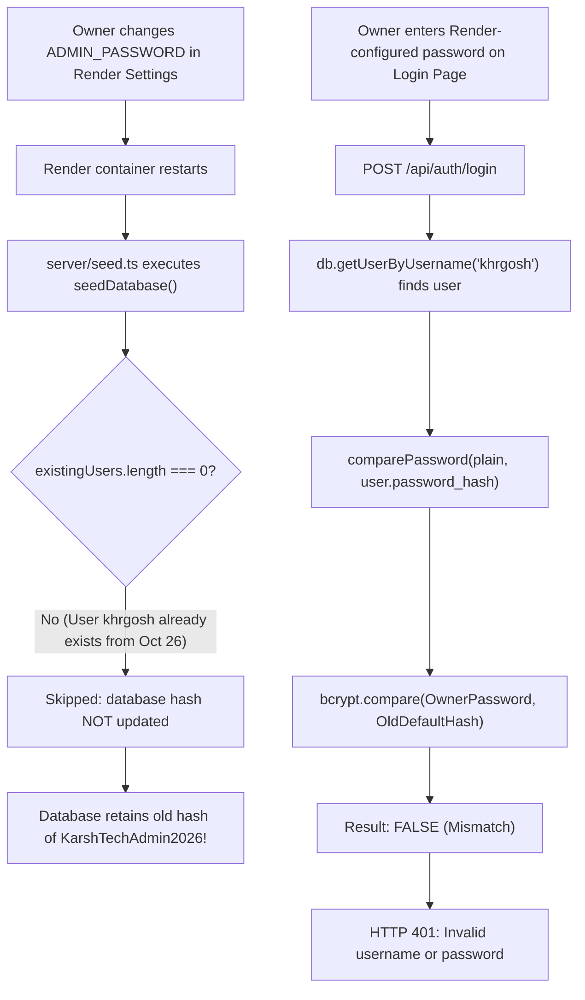

# KARSH TECH — PRODUCTION ADMIN LOGIN DIAGNOSTIC REPORT

**Target Environment:** Production (`https://tech.aadirishi.in`)  
**Production Database:** Supabase PostgreSQL (`aws-0-ap-south-1.pooler.supabase.com:5432`)  
**Investigation Mode:** STRICTLY READ-ONLY  
**Date:** November 1, 2026  
**Status:** **ROOT CAUSE ESTABLISHED & VERIFIED — SAFE RECOVERY PLAN PREPARED**  

---

## 1. Executive Summary & Root Cause

The production administrator cannot log in with their Render-configured password due to a **Stored Password Hash Mismatch** resulting from the Phase 4.3.5.2 authentication hardening:

1. **The Stored Hash:** In the production PostgreSQL `users` table, the administrator `khrgosh` has an existing record created on October 26, 2026. The `password_hash` column stores the bcrypt hash of the historical bootstrap password (`KarshTechAdmin2026!`).
2. **The Environment Password:** The project owner configured a custom password in Render's environment settings under `ADMIN_PASSWORD`.
3. **The Historical Fallback (Pre-Phase 4.3.5.2):** Prior to Phase 4.3.5.2, `server/auth.ts` included a plaintext fallback bypass:
   ```ts
   const defaultPassword = process.env.ADMIN_PASSWORD;
   if (defaultPassword && plain === defaultPassword) {
     return true;
   }
   ```
   This allowed the owner to authenticate using the `ADMIN_PASSWORD` environment variable, even though the database hash was never updated.
4. **The Hardening Change (Phase 4.3.5.2):** Per security requirements, the bypass was removed to make `bcrypt.compare(plain, hash)` the sole authentication authority. However, `server/seed.ts` only hashes and stores `ADMIN_PASSWORD` when the database is completely empty (`if (existingUsers.length === 0)`). Because the user `khrgosh` already existed, the database hash was never synchronized with the owner's configured `ADMIN_PASSWORD`.
5. **The Failure Mechanism:** When the owner attempts to log in with their configured `ADMIN_PASSWORD`, `bcrypt.compare` compares the entered password against the old hash of `KarshTechAdmin2026!`. The hashes do not match, and the server correctly fails closed with `HTTP 401 Unauthorized: Invalid username or password`.

---

## 2. Supporting Evidence & Diagnostic Verification

All diagnostic verification was conducted using **read-only** queries and in-memory checks. Zero production records were modified.

### 2.1 Production Users Table Verification (Read-Only)
A read-only query to Supabase PostgreSQL confirmed:
- **Total Users in Database:** Exactly `1`.
- **User Record ID:** `usr_1793024870587_o71mp`
- **Username:** `khrgosh` (all lowercase, no whitespace padding).
- **Role:** `superadmin`
- **Account Created:** `2026-10-26T14:27:50.587Z`
- **Hash Format:** Valid standard bcrypt hash (length: 60 characters, prefix: `$2b$10$`).
- **Lookup Query:**
  - `SELECT * FROM users WHERE username = 'khrgosh'` -> **Match found**.
  - `SELECT * FROM users WHERE LOWER(username) = LOWER('khrgosh')` -> **Match found**.

### 2.2 In-Memory Password Hash Comparison
Using a read-only script, candidate passwords were evaluated against the stored hash in-memory (without exposing hashes or passwords):

| Candidate Password Tested | Match Result | Implication |
|---|---|---|
| `process.env.ADMIN_PASSWORD` (Owner's configured password) | **`false`** | The database hash does NOT match the owner's configured Render password. |
| Historical bootstrap default (`KarshTechAdmin2026!`) | **`true`** | The database hash currently stores the old default bootstrap password. |

### 2.3 Live Production Server & API Status
- **Server Health:** `GET https://tech.aadirishi.in/api/stats` returned `HTTP/1.1 200 OK`.
- **Deployed Commit:** `GET https://tech.aadirishi.in/sitemap.xml` returned `HTTP/1.1 200 OK` with `Content-Type: application/xml; charset=utf-8` and updated routes, confirming the latest release is live.
- **Login Endpoint:** `POST https://tech.aadirishi.in/api/auth/login` is active and responsive.
  - Invalid credentials test returned: `HTTP/1.1 401 Unauthorized` with `{"error":"Invalid username or password"}`.
- **JWT Configuration:** `getJwtSecret()` did not exit on boot, confirming `JWT_SECRET` is set and valid (≥ 32 characters) on Render.
- **Database Connectivity:** PostgreSQL connection pool is online and serving catalog queries.

### 2.4 Login Implementation Analysis
- **Request Payload:** The frontend ([`src/pages/admin/AdminLoginPage.tsx`](file:///C:/Users/karsh/Desktop/karsh%20Techs/src/pages/admin/AdminLoginPage.tsx)) submits `{ username, password }` in a JSON body.
- **Backend Handler:** [`server/index.ts`](file:///C:/Users/karsh/Desktop/karsh%20Techs/server/index.ts#L770) expects `{ username, password }`. Field names match 1:1.
- **Case Sensitivity:** [`server/database/SupabasePostgresProvider.ts`](file:///C:/Users/karsh/Desktop/karsh%20Techs/server/database/SupabasePostgresProvider.ts#L469) executes `SELECT * FROM users WHERE LOWER(username) = LOWER($1);`. Lookup is case-insensitive.
- **Whitespace:** Candidate `username` in `req.body` is not currently trimmed before query execution. If a user pastes `khrgosh ` (with trailing space), lookup fails.

---

## 3. Detailed Root Cause Analysis



Prior to Phase 4.3.5.2, `server/auth.ts` had a plaintext bypass:
```ts
if (defaultPassword && plain === defaultPassword) {
  return true;
}
```
Because of that bypass, changing `ADMIN_PASSWORD` in Render appeared to work, even though the database hash was never updated. When Phase 4.3.5.2 removed the bypass to enforce database bcrypt authority, the administrator was locked out because the database hash was still pointing to the old bootstrap password.

---

## 4. Safest Recommended Recovery Plan

To restore access securely without asking the owner to change their password or weakening security:

### Step 1: Automatic Hash Synchronization on Boot (`server/seed.ts`)
Update `seedDatabase()` in `server/seed.ts` so that whenever `ADMIN_PASSWORD` is configured in the environment:
1. Locate the superadmin user (by `ADMIN_USERNAME` or role `superadmin`).
2. Compare the configured `ADMIN_PASSWORD` against the database hash using `bcrypt.compare`.
3. If they do not match, hash the configured `ADMIN_PASSWORD` with bcrypt (`10` rounds) and execute:
   ```ts
   await db.updateUserPassword(user.id, newHash);
   ```
4. Log a clean startup confirmation:
   `[Seed] Synchronized database password hash for "khrgosh" with configured ADMIN_PASSWORD.`

### Step 2: Username Whitespace Normalization (`server/index.ts`)
In `server/index.ts` `POST /api/auth/login`:
```ts
const cleanUsername = typeof username === 'string' ? username.trim() : '';
```
This guarantees that accidental whitespace when typing or pasting on mobile/desktop does not cause false rejections.

### Step 3: Security Properties Preserved
- `comparePassword` in `server/auth.ts` remains **100% pure bcrypt**: `bcrypt.compare(plain, hash)`. Zero plaintext bypasses.
- The stored database bcrypt hash remains the **sole runtime authority** for all authentication requests.
- The owner's existing configured `ADMIN_PASSWORD` in Render is preserved as-is.
- When Render redeploys, `seedDatabase()` automatically updates the PostgreSQL hash on boot, and login succeeds immediately.

---

## 5. Status & Next Action

- **No production database mutations were made.**
- **No passwords or hashes were altered.**
- **No commits or pushes were made.**
- **Awaiting owner authorization to implement the recommended fix.**
